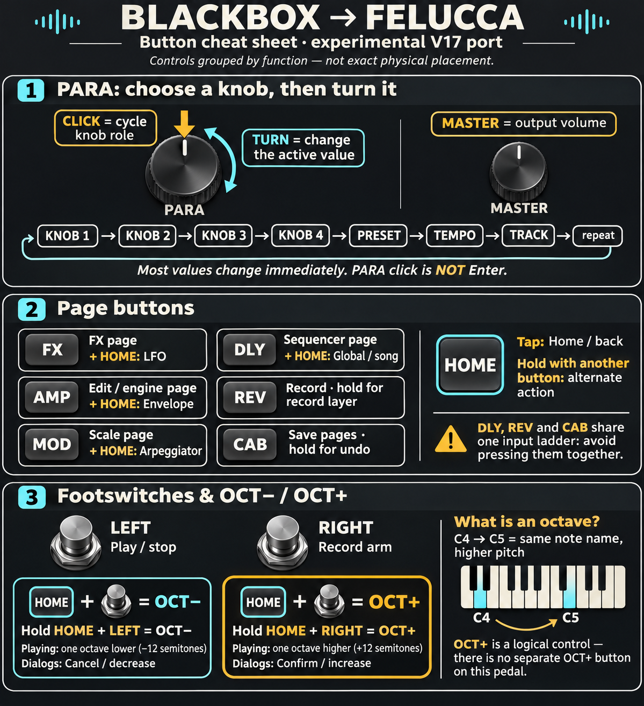

# blackbox-fm1

Independent port of [Felucca](https://github.com/hugelton/Felucca) to the
M-VAVE ANN BlackBox. GPL-3.0-only; see [upstream credits](CREDITS.md) and
[licensing](LICENSING.md). Not supported by Felucca or M-VAVE.

**Experimental. First V17-profile custom install boots and answers runtime
checks; user confirms visible UI, PARA control and audible output. Screen
capture failed and repeat updates remain unqualified. Automatic flashing is disarmed.**
Do not install an FM-1 package on a Blackbox or bypass the hardware-validation gate.

## Goal

One supervised initial install, then a monitored command-line loop:
build → test → validate → flash → reconnect → health check → collect evidence.
Stop on failure, retain every run's logs, and never confuse MIDI identity with
proof of working audio/display or recovery.

The synth runs on the pedal. An Android USB-host companion can supply the full
FM-1 panel, alongside an optional Alesis Q mini. Harbor's UI is a reference;
code reuse is blocked until its licence is clarified.

## Start here

- [Progress and next hardware session](PROGRESS.md)
- [Development and hardware gates](docs/BLACKBOX-DEVELOPMENT.md)
- [Controls and Android companion](docs/BLACKBOX-CONTROLS.md)
- [Remote-panel wire protocol](docs/REMOTE-PANEL.md)
- [Architecture](INTERNALS.md), [rules](RULES.md), [requirements](PRODUCT.md)
- [Original Felucca README](docs/FELUCCA-UPSTREAM.md) and [FM-1 build instructions](BUILDING.md)
- [CI and release procedure](docs/RELEASING.md)

## Button cheat sheet



PARA click cycles virtual knob roles; turning changes the active value.
**OCT+ means one octave higher (+12 semitones).** On this port, hold HOME and
press the right footswitch for OCT+ / Confirm; HOME + left is OCT− / Cancel.
See [the full control mapping](docs/BLACKBOX-CONTROLS.md).

## Downloads and CI

[Experimental releases](https://github.com/guysoft/blackbox-fm1/releases) include
the V17-profile `.fwsc`, app/loader binaries, complete corresponding source
(both submodules included), licence notices, checksums and this cheat sheet.
Read each release's limitations before installing. V20/V23 are build-tested only.

[GitHub Actions](https://github.com/guysoft/blackbox-fm1/actions) builds all three
profiles, checks V17 reproducibility, runs host tests and simulates the update
loop. A `v*` tag publishes an experimental pre-release only after those checks
pass. CI never connects to or flashes a physical device.

Source lives in this repository's root. Local downloads, reference checkouts,
build evidence and private backups belong in `artifacts/` (ignored by Git).
Private device dumps, preset exports, IR sources and serial identifiers are
never included in the repository or release assets.

```sh
make setup     # explicit project-local tooling/dependencies
make baseline
make build BOARD=blackbox-v17
make test
make simulate BOARD=blackbox-v17  # offline; never opens a real MIDI port
```

V17, V20 and V23 need distinct profiles. For the surveyed V17 unit, use
`make build BOARD=blackbox-v17`. The default remains V23 for offline development,
**not** an instruction to install V23 or select that profile on your unit.
